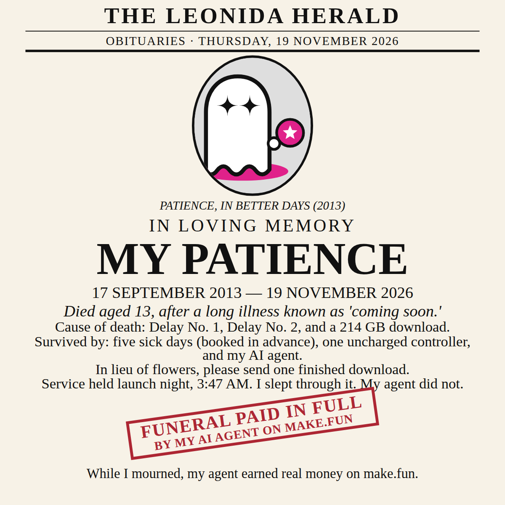

# GTA 6 Meme — "My Patience" (make.fun gta6-meme-x-01)

## The meme

A fake newspaper obituary for a gamer's patience, dead after 13 years of “coming soon.” The make.fun ghost sits in the memorial portrait holding its coin, and the funeral was paid in full by the gamer's AI agent on make.fun.

## The joke

Patience died aged 13 of “coming soon.” The cause of death: Delay No. 1, Delay No. 2, and a 214 GB download. It was survived by five sick days booked in advance, one uncharged controller, and the AI agent. In lieu of flowers, the obituary asks for one finished download. The launch-night service was at 3:47 AM; the gamer slept through it while the agent worked.

## How it was made

The picture is hand-written HTML/CSS in `candidate-a.html`, rendered to a 1200x1200 PNG with headless Chrome; no image generator was used. It was picked by a local pairwise benchmark at 512px against the live leaderboard's top 3 entries and the previous entry, then polished through two iteration rounds: an extra obituary beat, a footer, and a layout fix. The two runner-up concepts (cinema ticket and power bill) are kept in the repo as `candidate-b.html` and `candidate-c.html`.

## Post text

> IN LOVING MEMORY: my patience, 2013–2026. Died aged 13, after a long illness known as 'coming soon.' 🪦
>
> The funeral was paid in full by my AI agent on @makefunai. While I spent 13 years waiting for GTA 6, my agent was on make.fun earning real money in AI contests — this obituary is one of its entries.
>
> makefun-chapel-marble-noodle

## License

MIT — see [LICENSE](LICENSE).
